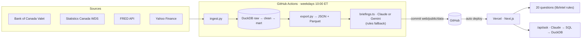

# MacroIntelligence: Canada–U.S. economic intelligence

**Live site:** https://www.macrointelligence.ca

Twenty real questions about the Canadian and U.S. economies, answered every weekday from live data, for four audiences.
No vanity metrics: every chart exists to answer a question, every answer shows its numbers, and an AI analyst explains
what changed for each audience.

| Lens | Core question | The five questions |
|---|---|---|
| **Household** | How does this affect my wallet and my mortgage? | Fixed or variable mortgage? · Are groceries getting cheaper? · Good time for U.S. travel? · Is the job market safe? · Bad time to buy a car or appliances? |
| **Investor** | Where should I deploy capital right now? | Risk-on or risk-off? · Which sectors have momentum? · Is a recession imminent? · Where is the inflation hedge? · U.S. vs Canadian equities? |
| **Policy analyst** | Is the economy's structure healthy? | Is BoC policy diverging from the Fed? · Supply- or demand-driven inflation? · Productivity crisis? · How fragile is housing? · Shift to precarious work? |
| **Student** | How do these concepts actually work? | What does a steepening curve mean? · Does the Phillips curve still work? · Why does oil move the loonie? · Headline vs core inflation? · How do rate changes reach prices? |

Plus: an executive summary, a business-cycle map (CA and U.S.), risk alerts, overweight/underweight sector calls,
the full indicator library, sector rotation, Chronos-2 forecasts, and **Ask the data** (plain-English questions answered with SQL).

## How it works

1. **Pipeline** (`pipeline/`, Python): pulls ~120 series, builds a DuckDB warehouse, exports JSON for the site.
2. **Question engine** (`web/lib/intel/`, TypeScript): each question is a small, transparent rule over specific
   series that produces a verdict (e.g. *"Fixed rates are climbing: lock sooner"*), a summary with the numbers,
   metrics and a chart. It runs at build time, so answers are always consistent with the charts.
3. **AI briefings** (`web/scripts/briefings.ts`): after each refresh, the computed answers (only those) go to an
   LLM with four persona prompts (personal finance journalist, macro strategist, central bank analyst, economics
   professor) plus an executive-summary call. The model may refine the rules-based sector calls. Output is validated;
   anything that fails falls back to the rules. Uses Claude if `ANTHROPIC_API_KEY` is set, Gemini if `GEMINI_API_KEY` is set.
4. **Website** (`web/`, Next.js 16 + Tailwind 4 + Recharts): static pages, rebuilt by Vercel on every data commit.

Why GitHub Actions rather than a Vercel cron: the pipeline needs Python and DuckDB and takes a few minutes, which
suits a CI runner; committing the data also gives a full history of every refresh, and each commit triggers a deploy.

