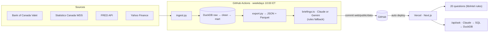

# MacroIntelligence: Canada–U.S. economic intelligence

**Live site:** https://www.macrointelligence.ca

Twenty real questions about the Canadian and U.S. economies, answered every weekday from live data, for four audiences.
No vanity metrics: every chart exists to answer a question, every answer shows its numbers, and an AI analyst explains
what changed for each audience.

| Lens | Core question | The five questions |
|---|---|---|
| **Household** | How does this affect my wallet and my mortgage? | Fixed or variable mortgage? · Are groceries getting cheaper? · Good time for U.S. travel? · Is the job market safe? · Bad time to buy a car or appliances? |
| **Investor** | Where should I deploy capital right now? | Risk-on or risk-off? · Which sectors have momentum? · Is a recession imminent? · Where is the inflation hedge? · U.S. vs Canadian equities? |
| **Policy analyst** | Is the economy's structure healthy? | Is BoC policy diverging from the Fed? · Supply- or demand-driven inflation? · Productivity crisis? · How fragile is housing? · Shift to precarious work? |
| **Student** | How do these concepts actually work? | What does a steepening curve mean? · Does the Phillips curve still work? · Why does oil move the loonie? · Headline vs core inflation? · How do rate changes reach prices? |

Plus: an executive summary, a business-cycle map (CA and U.S.), risk alerts, overweight/underweight sector calls,
the full indicator library, sector rotation, Chronos-2 forecasts, and **Ask the data** (plain-English questions answered with SQL).

## How it works



1. **Pipeline** (`pipeline/`, Python): pulls ~120 series, builds a DuckDB warehouse, exports JSON for the site.
2. **Question engine** (`web/lib/intel/`, TypeScript): each question is a small, transparent rule over specific
   series that produces a verdict (e.g. *"Fixed rates are climbing: lock sooner"*), a summary with the numbers,
   metrics and a chart. It runs at build time, so answers are always consistent with the charts.
3. **AI briefings** (`web/scripts/briefings.ts`): after each refresh, the computed answers (only those) go to an
   LLM with four persona prompts (personal finance journalist, macro strategist, central bank analyst, economics
   professor) plus an executive-summary call. The model may refine the rules-based sector calls. Output is validated;
   anything that fails falls back to the rules. Uses Claude if `ANTHROPIC_API_KEY` is set, Gemini if `GEMINI_API_KEY` is set.
4. **Website** (`web/`, Next.js 16 + Tailwind 4 + Recharts): static pages, rebuilt by Vercel on every data commit.

Why GitHub Actions rather than a Vercel cron: the pipeline needs Python and DuckDB and takes a few minutes, which
suits a CI runner; committing the data also gives a full history of every refresh, and each commit triggers a deploy.

## Deploy (Windows, VS Code, GitHub, Vercel)

1. **Copy the code in.** In VS Code, open your local clone of `jeduclo/northstar` and pull the latest `main`.
   **Option A (patch, recommended):** save `macrointelligence.patch` into the repo folder and run
   `git checkout -b question-driven-site; git am macrointelligence.patch` (handles the moved files for you).
   **Option B (zip):** first delete the old folder, which moved to `web/app/data/[tab]` and would clash with the new routes:
   `Remove-Item -LiteralPath "web\app\[tab]" -Recurse -Force`, then extract the zip over the repo, replacing files.
   Then in the VS Code terminal (PowerShell):
   ```powershell
   git checkout -b question-driven-site   # skip if you used option A
   git add -A
   git status        # review
   git commit -m "Rebuild as question-driven economic intelligence site"
   git push -u origin question-driven-site
   ```
   Open a pull request on GitHub and merge it into `main` (or commit straight to `main` if you prefer).
   Note that the old pages `app/[tab]` and `app/page.tsx` moved to `app/data/...`; `git add -A` records that.

2. **GitHub secrets** (repo → Settings → Secrets and variables → Actions):
   | Name | Required | Purpose |
   |---|---|---|
   | `FRED_API_KEY` | yes (existing) | FRED API from CI |
   | `ANTHROPIC_API_KEY` **or** `GEMINI_API_KEY` | recommended | Written AI briefings. Without either, the site shows rules-based summaries |
   | Variable `BRIEFING_MODEL` | optional | Override the model (defaults: `claude-sonnet-5-5` or `gemini-2.5-flash`) |

3. **Vercel** (project settings): keep the Root Directory as `web`. Environment variables:
   | Name | Purpose |
   |---|---|
   | `ANTHROPIC_API_KEY` | Ask the data (existing) |
   | `ANTHROPIC_MODEL` (optional) | Ask-the-data model, default `claude-haiku-5-5` |

4. **Run the refresh once by hand:** GitHub → Actions → *Daily data refresh* → *Run workflow*. This fetches the
   new series (CPI components, new-home prices, part-time jobs, gold, copper, high-yield spreads, more yield-curve
   points), writes `momentum.json` and the AI briefing, commits, and Vercel deploys. Until then, the affected
   answers use fallbacks and say which data is pending.

## Run locally (Windows PowerShell)

```powershell
# Website
cd web
npm install
npm run dev                         # http://localhost:3000

# Optional: AI briefing locally (uses whichever key is set)
$env:ANTHROPIC_API_KEY = "sk-ant-..."
npm run briefings

# Pipeline (Python 3.11+)
cd ..
python -m venv .venv
.venv\Scripts\Activate.ps1
pip install -r pipeline/requirements.txt
$env:FRED_API_KEY = "..."
python -m pipeline.ingest; python -m pipeline.build; python -m pipeline.export
```

## Add or change a question

Questions live in `web/lib/intel/{household,investor,policy,student}.ts`. Each is a function returning an `Answer`
(question, verdict, summary, metrics, chart, explanation, sources). To use a new series: add a row to
`pipeline/reference/catalog.csv` (mark it `optional=1` so a failure never blocks the refresh), add its source ID in
the right `pipeline/sources/*.py`, then read it with `get("series_name")` in the question.

## Repository layout

```
pipeline/            sources/ (boc, fred, statcan_series, markets) · sql/ · reference/catalog.csv · models/
web/lib/intel/       the 20 questions, business cycle, sector calls, risk alerts
web/scripts/         briefings.ts (AI persona briefings)
web/app/             / (overview) · /[lens] · /data/[tab] (indicators) · /rotation · /outlook · /ask · /methodology
web/public/data/     exported JSON + Parquet (written by the pipeline; do not edit by hand)
```

## Notes

- **Data stopped refreshing on Oct 20, 2026.** A likely cause: `pip` installed DuckDB 2.0, whose stricter result
  handling broke the summary printout in `pipeline/build.py`. That is fixed here and DuckDB is pinned to `<3`. If the
  Action still fails, its log names the failing step.
- New StatCan series are matched by table and member name and fail safely (hidden, not blocking) if a name doesn't match.
- Model outputs (`forecasts.json`, `causal_effects.json`) refresh only when the Colab notebook is re-run.
- The web build uses `next build --webpack`: Turbopack's symlinks fail to load DuckDB's native binary on Vercel.
- General information, not investment or financial advice.
